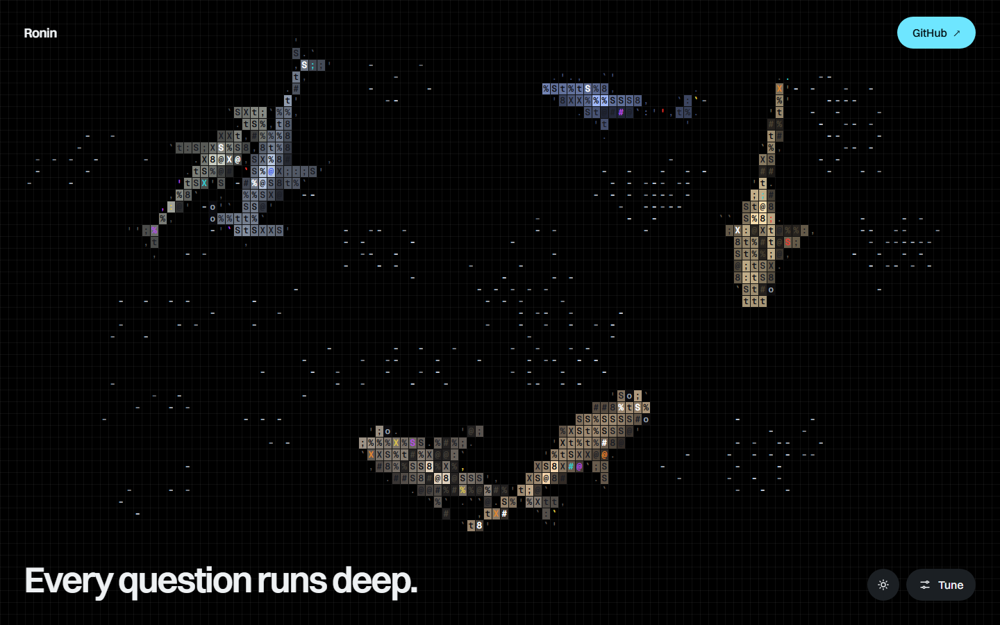
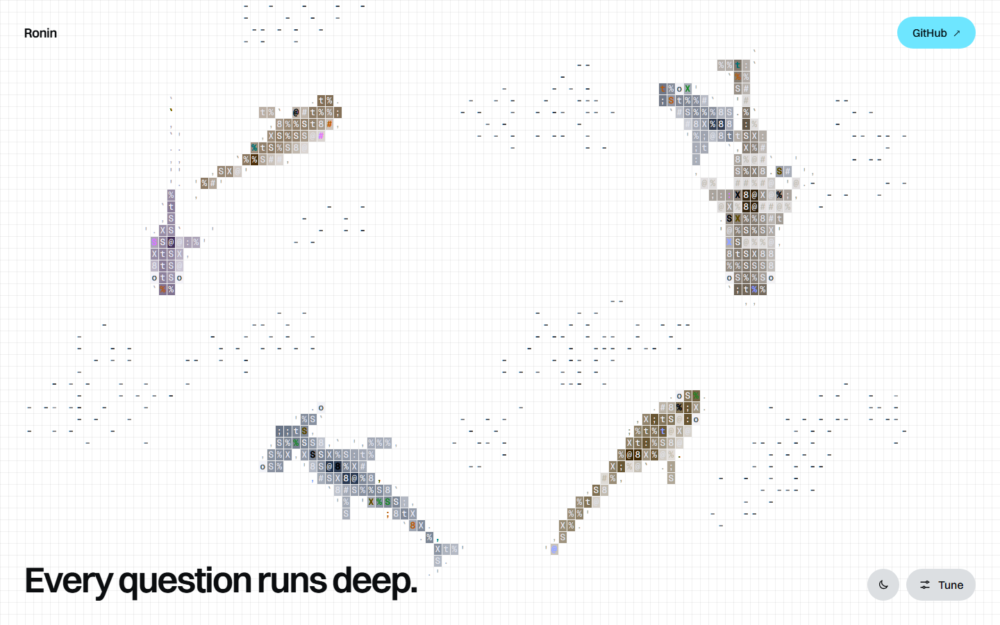

# Ronin landing page

| Dark | Light |
| --- | --- |
|  |  |

The landing page for [Ronin](https://github.com/mathblender17/Ronin), the rabbit hole explorer. The hero is a live ASCII ocean of sharks and fish you can steer from the **Tune** panel: species (or a mixed school), school size, a cursor that scares the fish or baits the sharks, and clicks that splash or drop food. Tune also switches each piece of on-screen UI on or off; **H** leaves only the ocean. The sun/moon button beside it switches between dark and light; `?theme=light` or `?theme=dark` in the URL opens the page in either.

## Run

The page is static. Open `site/index.html` directly, or serve the folder:

```sh
deno run --allow-net --allow-read jsr:@std/http@1.0.9/file-server site --port 4173
```

## Edit

- Link, product name and contact email: `RONIN_CONFIG` near the bottom of `site/index.html`.
- The ocean: `site/src/ocean.ts` wraps the engine in `vendor-ascii-sharks/`. After changing either, rebuild the bundle:

```sh
deno run -A npm:esbuild@0.24.0 site/src/ocean.ts --bundle --format=iife --global-name=RoninOcean --minify --target=es2020 --outfile=site/ocean.js
```

## Credits

- ASCII ocean engine: [stackedlol/ascii-sharks](https://github.com/stackedlol/ascii-sharks), vendored at upstream commit `c521e24`. Ronin's local changes are in `world.ts` (cursor bait, food, optional clear centre), `engine.ts` (cursor and click modes) and `renderer.ts` (food glow).
- Prints: Hokusai and Hiroshige from The Met (CC0); Kuniyoshi and the Oki Province register from Wikimedia Commons (public domain); sea footage from Wikimedia Commons (CC0). Sources and licences are listed in `site/assets/credits.json`.
